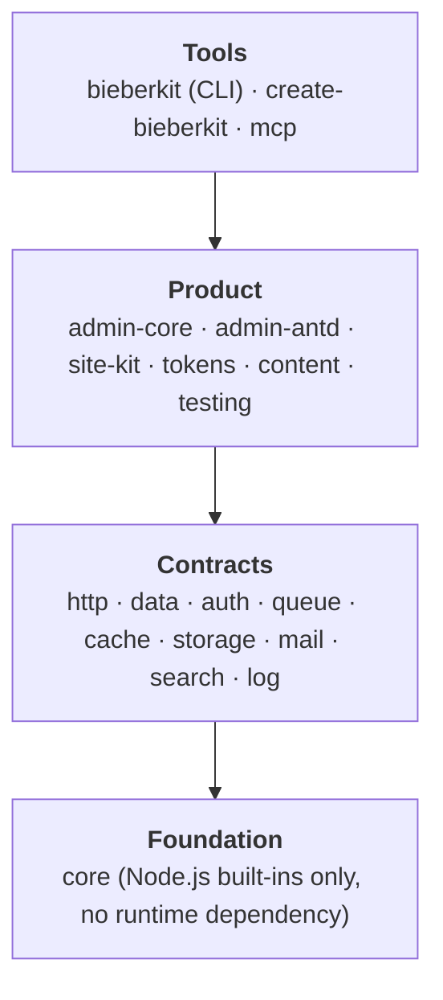

<!--
  BieberKit

  @file        README.md
  @description Overview of the BieberKit framework repository: what it is, where it stands before its first beta, how it is built and how to contribute.
  @author      Bieber Kieu <kieutrongthien@gmail.com>
  @copyright   Copyright (c) 2026 Bieber Kieu
  @license     Apache-2.0

  Licensed under the Apache License, Version 2.0 (the "License");
  you may not use this file except in compliance with the License.
  You may obtain a copy of the License at

      http://www.apache.org/licenses/LICENSE-2.0

  Unless required by applicable law or agreed to in writing, software
  distributed under the License is distributed on an "AS IS" BASIS,
  WITHOUT WARRANTIES OR CONDITIONS OF ANY KIND, either express or implied.
  See the License for the specific language governing permissions and
  limitations under the License.

  SPDX-License-Identifier: Apache-2.0
-->

<div align="center">

<picture>
  <source media="(prefers-color-scheme: dark)" srcset="docs/assets/logo-dark.svg">
  
</picture>

**The TypeScript framework for management-style web apps and APIs.**
One command. API, admin, auth, permissions, queue, cache and storage already wired.

_Yes, the name is Bieber. No, not that one. [The story is below.](#the-name)_

[](LICENSE)
[](docs/ROADMAP.md)
[](#development)
[](AGENTS.md)

[Specification](docs/spec/SPEC.md) · [Roadmap](docs/ROADMAP.md) · [Decisions](docs/adr/README.md) · [Module specs](docs/modules/README.md) · [Contributing](CONTRIBUTING.md)

</div>

---

## The name

**"Bieber" is a nickname, and it is mine.** I am Bieber Kieu. Years ago I was a big fan of Justin Bieber, the nickname stuck to me, and it never left. So when I got tired of rebuilding the same login, roles, uploads and audit log for every project and decided to build them once, there was only one name to give the toolkit.

> **Not affiliated.** BieberKit has nothing to do with Justin Bieber, his team or his music. He did not create it, endorse it or sponsor it. The name comes from the nickname of the person who wrote the code.

A few questions that I get asked, or will be:

- **Does it sing?** No. It does run a `worker` that never gets tired and a `scheduler` that is never late.
- **Does it say sorry?** Not just that. Every error has a stable code, a message and a fix, so you are told what to do and not only that something went wrong.
- **And the Kit?** It is a kit: the plugs and wires that every back office needs, ready to connect, so that you spend your time on the part that is yours.
- **Is there a fan club?** Contributors are welcome, and we have not found a name for you yet. Suggestions go in an issue.

## Why BieberKit

Every new back-office, CMS or CRM project rebuilds the same parts: login, roles, CRUD screens, uploads, background jobs, settings and audit logs. BieberKit is that shared part, built once, tested on real databases and kept upgradable.

- **Declare an entity once.** `defineEntity` derives the database schema, validation, REST routes, OpenAPI 3.1, permissions, admin metadata and test factories from one description.
- **Secure by default.** Server-side sessions, MFA, CASL permissions turned into query conditions, field masks, tenant isolation, an append-only audit log, CSRF and CSP, an SSRF guard, and a supply chain with a 7 day release age.
- **Built to scale out.** Stateless `web`, `worker` and `scheduler` roles, a transactional outbox, rate limits, OpenTelemetry and Prometheus without an SDK, and Docker files that you can read.
- **One way to do each thing.** Plugins add features, templates are presets of plugins, and a plugin owns its tables. No second path to learn.
- **Friendly to AI coding agents.** Stable error codes, `--json` on every command, generated files that are checked, and a short `AGENTS.md`.

## Status and versions

> **BieberKit is pre-beta, and there is no real release on npm yet.** The names are reserved there with empty placeholders at `0.0.1`, which you should not use. The first beta is prepared as version `0.2.0`. Release notes: [0.2.0 beta](docs/releases/0.2.0-beta.md). What is left is its first run on GitHub, which [docs/releasing.md](docs/releasing.md) explains.

How versions work:

- **One number for everything.** All 26 packages and plugins share one version, today `0.2.0`, so an upgrade moves one number.
- **Every `0.x` is a beta.** A minor version (`0.3.0`) may break things, and a patch (`0.2.1`) only fixes them. `1.0.0` comes after the security review and a pilot in production (roadmap M3.5). Until then no release is published as `latest`.
- **How a beta is published.** A tag on `main` named `v0.2.0-beta` publishes version `0.2.0` under the npm tag `beta`, with GitHub Actions and npm trusted publishing (ADR 0014). The suffix names the npm tag. It is not part of the version.
- **How to install one.** `pnpm add @bieberkit/core@beta`, or `pnpm create bieberkit@beta my-app`. Always ask for `@beta`: a plain name does not get a beta, and today `latest` still points at the empty placeholder `0.0.1`.
- **A fresh release waits 7 days** in a new project (`minimumReleaseAge`, SEC-11).

| Phase                    | What it holds                                               | State                                            |
| ------------------------ | ----------------------------------------------------------- | ------------------------------------------------ |
| 0. Foundations           | ADRs, repository, CI and release pipeline                   | Decisions accepted; the first GitHub run is open |
| 1. Core MVP              | Core, data, HTTP, auth, contracts, CLI, `blank`, deployment | Built (M1.1 to M1.9); the pilot project is next  |
| 2. Plugins and templates | Admin renderer, content and site, `cms`, `crm`, `saas`      | Started with the plugin system (M2.1)            |
| 3. Hardening and 1.0     | Security review, performance, upgrade path, documentation   | Not started                                      |

The roadmap is a checklist that is ticked only when its evidence exists: [docs/ROADMAP.md](docs/ROADMAP.md).

## A taste

An entity, as in [spec section 10](docs/spec/SPEC.md#10-entities-and-modules):

```ts
import { defineEntity, f, type EntityDef } from '@bieberkit/data';

export const Customer: EntityDef<'crm.Customer'> = defineEntity({
  name: 'crm.Customer',
  table: 'crm_customers',
  tenant: true,
  softDelete: true,
  fields: {
    id: f.id(),
    code: f.string({ max: 32 }).unique(),
    name: f.string({ max: 200 }).searchable().index(),
    email: f.email().optional(),
    tier: f.oneOf(['standard', 'gold', 'vip']).default('standard').index(),
    createdAt: f.createdAt(),
    updatedAt: f.updatedAt(),
  },
  permissions: {
    read: 'crm.customer.read',
    create: 'crm.customer.create',
    update: 'crm.customer.update',
    delete: 'crm.customer.delete',
    fields: { email: { read: 'crm.customer.read-pii' } },
  },
  api: { list: true, get: true, create: true, update: true, delete: true },
  admin: { title: 'name', list: ['code', 'name', 'tier'], icon: 'users' },
});
```

From these lines BieberKit derives the table and its migration, the validation, the list, get, create, update and delete routes, the OpenAPI document, the permission and tenant tests, and what the admin needs to draw a list and a form.

## Architecture

Imports point downward only, and `pnpm check:layers` enforces it (PKG-01).



Driver libraries (BullMQ, BentoCache, FlyDrive, mail transports) are imported only inside the `src/adapters/<driver>/` folder of a contract package, so switching a driver changes configuration and no application code.

**Stack:** Node.js 26 LTS (24.12 or later), TypeScript with erasable syntax only, pnpm, Fastify 5, MikroORM 7 on PostgreSQL, MySQL or SQLite, Better Auth, CASL, BullMQ on Valkey, BentoCache, FlyDrive, and React 19 with TanStack and Ant Design 6 for the admin. The full baseline is in [spec section 3](docs/spec/SPEC.md#3-technology-baseline).

## What is in the repository

| Area                     | Packages                                                                   | State                         |
| ------------------------ | -------------------------------------------------------------------------- | ----------------------------- |
| Foundation and contracts | `core`, `data`, `http`, `auth`, `queue`, `cache`, `storage`, `mail`, `log` | Built, tested on 3 dialects   |
| Runtime and tooling      | `server`, `testing`, `cli` (`bieberkit`), `create` (`create-bieberkit`)    | Built                         |
| Admin                    | `admin-core`, `admin-antd`                                                 | Thin slice: login, list, form |
| Content and public site  | `content`, `site-kit`, `tokens`                                            | Planned (Phase 2)             |
| Search and agents        | `search`, `mcp`                                                            | Planned                       |

| Plugin (`plugins/`) | What it gives a project                                       | State                     |
| ------------------- | ------------------------------------------------------------- | ------------------------- |
| `users`, `roles`    | Accounts and role-based access, with the administrator seeded | Baseline, being completed |
| `settings`          | Application settings                                          | Baseline, being completed |
| `audit-log`         | Reading the append-only audit trail                           | Baseline, being completed |
| `notifications`     | In-app notifications for a user                               | Baseline, being completed |
| `media`             | Direct, signed uploads with content checks                    | Baseline, being completed |

Starter templates are presets of plugins: `blank` (the base plugins and an administrator account) is in the scaffolder, and `cms`, `crm` and `saas` come in Phase 2. Other folders: `registry/` (copy-in UI blocks), `skills/` (Agent Skills shipped into generated projects), `examples/` and `tools/`.

## Getting started

**With the first beta** (not released yet, see [versions](#status-and-versions)):

```sh
pnpm create bieberkit@beta my-app
cd my-app && pnpm dev
```

**From source today**, to read, run the tests or contribute:

```sh
git clone https://github.com/kieutrongthien/bieberkit.git
cd bieberkit
sh tools/bootstrap.sh    # first time only: git hooks, dev tools, install, checks
```

## Development

Requirements: Node.js 26 LTS (24.12 or later), pnpm, git, and Docker for the database and Valkey tests.

```sh
pnpm check                              # headers, package layers, env access, skills, workflows, manifests
pnpm typecheck && pnpm lint && pnpm test && pnpm build
sh tools/test-services.sh start         # PostgreSQL, MySQL, Valkey and an S3 server for the full suite
BK_REQUIRE_DIALECTS=all pnpm test       # fail, and not skip, when a dialect is missing
```

Only pnpm is used. Every file carries the licence header of [spec section 23](docs/spec/SPEC.md), and `pnpm check:headers --fix` inserts a missing one.

## Contributing

Contributions follow [CONTRIBUTING.md](CONTRIBUTING.md): signed-off commits (DCO), Conventional Commits, a design document for a non-trivial change, and tests written from the spec first. The spec is the source of truth, and a change of behavior changes it in the same pull request. AI coding agents read [AGENTS.md](AGENTS.md). Please follow the [Code of Conduct](CODE_OF_CONDUCT.md).

## Security

Do not open a public issue for a vulnerability. Report it privately through the **Security** tab of the repository, as [SECURITY.md](SECURITY.md) explains.

## License

Apache License 2.0. See [LICENSE](LICENSE) and [NOTICE](NOTICE). Copyright 2026 Bieber Kieu.
